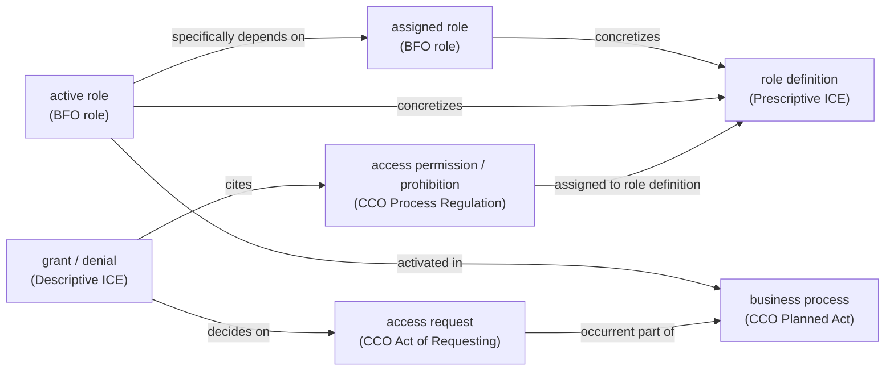
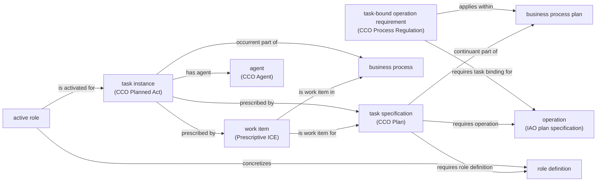

# RBO: role-based access control on BFO

RBO is a proposal for re-expressing the ROWLBAC patterns (Finin et al., "ROWLBAC: Representing Role Based Access Control in OWL", SACMAT '08, pp.73–82) on BFO 2020, using CCO v2.2 and IAO. It follows the NIST RBAC standard (Ferraiolo et al., "Proposed NIST Standard for Role-Based Access Control", ACM TISSEC 4(3), 2001, pp.224–274) wherever ROWLBAC departs from it. NIST sessions are replaced by business process instances. Tasks, permission and task separation of duty, and conflicting agents follow Botha and Eloff ("Separation of duties for access control enforcement in workflow environments", IBM Systems Journal 40(3), 2001, pp.666–682). Draft of 2026-11-01. Placeholder license CC BY 4.0. All IRIs are placeholders under `https://example.org/rbac-bfo/`.

## Contents

| Path | What it is |
|---|---|
| `rbo.ttl`, `rbo.owl` | The ontology (Turtle and RDF/XML): 49 classes, 48 object properties, 5 data properties, 4 annotation properties |
| `rbo-domain.ttl`, `rbo-domain.owl` | Scenario vocabulary: the US-persons role universals, rooms and devices, university roles (22 classes, 1 property) |
| `rbo-terms.csv` | Terms document in the column layout of the BFO 2020 terms CSV, with every new and borrowed term (167 rows) |
| `clif/rbo-access.cl` | First-order axioms in the style of the BFO 2020 CLIF modules, covering what OWL cannot state: time-indexed seniority, SSD and DSD counting over roles, permissions and tasks, permissions compared by content, agents counted as one, principals, strict least privilege, task-bound operations, refusal of a request that would complete a dynamic permission set, deny-overrides, RT role linking (48 axioms) |
| `queries/` | SPARQL 1.1 derivations, checks and competency questions (32 files plus `_prefixes.rq`) |
| `data/` | Example data: `us-persons.ttl` (ROWLBAC §3.1), `code-review.ttl` (CR-42), `abac.ttl` (§4.1), `rt-policy.ttl` (§4.2, Figure 4), `purchase.ttl` (Botha and Eloff's purchase workflow: ten process instances and one conflicting assignment), and `probes.ttl`, eight regression probes for the corrections of 2026-10-31 (design-record D15), read over the purchase data; `run_queries.py` fails if a probe gives a result other than the one it must. Built by `tools/build_data.py`, which writes each file in dependency order (`tools/ttl_ordered.py`): a block comes after every block it refers to, so the file reads in the order the scenario is built, with each act's interval and instants just above it. `data/derived/` holds the decisions and conflict reports the queries wrote |
| `imports/` | Local copies of BFO 2020 core and seven CCO v2.2 modules (byte-identical, `SHA256SUMS`), and the IAO extract |
| `imports/bfo-clif/` | The 13 BFO 2020 CLIF modules, generated 2025-12-05 (byte-identical, `SHA256SUMS`), for the first-order checks |
| `sources/` | The three papers RBO is built from, as supplied (byte-identical, `SHA256SUMS`); see Sources below |
| `catalog-v001.xml` | Resolves all imports to `imports/`, so Protégé opens the ontology offline |
| `docs/mapping.md` | ROWLBAC patterns P1–P18 and the scenario, mapped to RBO terms and queries, with NIST counterparts and verdicts |
| `docs/critique.md` | 17 findings on ROWLBAC, each with how it was checked |
| `docs/design-record.md` | The decisions, the options weighed, and which parts are interpretation |
| `docs/botha-review.md` | Botha and Eloff (2001) reviewed against the 2026-10-29 draft: alignment, the hierarchy bypass, ten proposals and how each was settled, and the Figure 6 finding from the purchase dataset |
| `docs/verification.md` | What was checked, the measurements, and what remains open |
| `docs/query-results.md` | Generated output of the last SPARQL and RL run |
| `docs/dl/inferences.txt` | What HermiT inferred beyond the asserted axioms, and the negative controls |
| `docs/fol-results.md` | Generated output of the last Prover9 and Mace4 run |
| `docs/fol/` | The LADR theories the two hand-specified models were tested against, their specifications (`hand-*.py`), and the clausetester results |
| `tools/` | The scripts that built the extract, the RDF/XML, the terms CSV and the data, and the ones that run the checks; `run_all.sh` runs every check in order |
| `tools/ladr/` | `build_ladr.sh` and three header shims: how Prover9, Mace4 and clausetester were built on Windows |
| `MANIFEST.sha256` | Hash of every file above, `sources/` included |

## Sources

Page numbers cited anywhere in this directory (`p.674`, `pp.224–274`) are the printed page numbers of these files, not PDF page indices.

| File | Citation | Pages | Supplied as |
|---|---|---:|---|
| `sources/finin-2008-rowlbac.pdf` | T. Finin, A. Joshi, L. Kagal, J. Niu, R. Sandhu, W. Winsborough and B. Thuraisingham, "ROWLBAC: Representing Role Based Access Control in OWL", *SACMAT '08*, pp.73–82 | 10 | `ROWLBAC - Representing Role Based p73-finin.pdf` |
| `sources/ferraiolo-2001-nist-rbac.pdf` | D. F. Ferraiolo, R. Sandhu, S. Gavrila, D. R. Kuhn and R. Chandramouli, "Proposed NIST Standard for Role-Based Access Control", *ACM TISSEC* 4(3), 2001, pp.224–274 | 51 | `Proposed NIST Standard for RBAC 501978.501980.pdf` |
| `sources/botha-eloff-2001.pdf` | R. A. Botha and J. H. P. Eloff, "Separation of duties for access control enforcement in workflow environments", *IBM Systems Journal* 40(3), 2001, pp.666–682 | 17 | `Separation of duties - botha.pdf` |

The papers are the publishers' copyright and are here for checking citations locally. They are not covered by RBO's license; remove `sources/` before sharing this directory outside your own use.

## Opening it

Open `rbo-domain.owl` in Protégé from this directory. The catalog resolves the imports.

To read the Turtle directly: in `rbo.ttl` and `rbo-domain.ttl`, every term block has a header comment with its label (`#: rbo:RBO_0000113  cites regulation`), and every line naming a labeled RBO, BFO, CCO or IAO IRI has a trailing `#:` comment giving the labels in order. `tools/annotate_ttl.py` writes them from the labels in the ontology and its imports and owns every `#:` comment, so do not edit those by hand. After changing a label or adding a term, rerun it:

```bash
python tools/annotate_ttl.py .
```

`--check` writes nothing and fails if any comment is stale. Comments are not part of the graph, so a file saved from Protégé or re-serialized by rdflib loses them; rerun the tool afterwards.

The data files carry the same comments on the classes and properties they use (`ex:officer a cco:ont00001262 ;  #: Person`). The individuals' own IRIs are readable and get none. `build_data.py` and `run_queries.py` annotate each file they write, so regenerating the data keeps them.

## Running the checks

`tools/run_all.sh` runs every check except the hand-specified models below, in order, writing reasoner and prover output and a log per step to a folder you name. Each step is one line of the script, so a check can also be run on its own with the arguments shown there.

```bash
sh tools/run_all.sh python path/to/robot.jar path/to/ladr-bin out
```

The checks need Python 3 and rdflib 7. With rdflib 7.6.0 the query run takes about a minute; with any other version `run_queries.py` leaves out its evaluation shortcuts, which were checked on 7.6.0 only, and takes more than ten times as long (`docs/design-record.md` D17). The DL checks need Java and ROBOT 1.9.8 (`robot.jar`). The first-order checks need `prover9` and `mace4` from LADR 2009-11A; on Windows, `tools/ladr/build_ladr.sh <source> <out> <gcc-bin>` builds them, with clausetester, from github.com/ai4reason/Prover9 at commit `cdca95a5`. A fifth argument, `--full`, adds the Mace4 searches over the BFO set, which run to their time limits.

Mace4 finds no model in 300 s for two of the regression probes' scenarios. For each, `tools/check_hand_model.py` checks a hand-specified interpretation instead. Each interpretation is saved in `docs/fol/` with the theory `run_fol.py` wrote for it on 2026-11-03 (the 48-axiom RBO theory, the bridge and the scenario facts), and the tool runs `clausetester` on the theory and on the goals of the scenario's Prover9 runs:

```bash
python tools/check_hand_model.py docs/fol/m-t1-pdsd-same-content.in docs/fol/hand-pdsd-same-content.py path/to/clausetester hand-out
python tools/check_hand_model.py docs/fol/m-t1-pdsd-same-instant.in docs/fol/hand-pdsd-same-instant.py path/to/clausetester hand-out
```

The SPARQL files take the evaluation time as the placeholder `?evalTime`. `run_queries.py` puts an `xsd:dateTime` literal in its place, giving each query the algebra the substituted text would have, because rdflib's initial bindings do not reach subqueries. A caller using another engine should substitute the literal in the text, and run the queries in the order the runner's docstring gives, since later ones read what earlier ones wrote, some of it in the query-internal namespace `rbow:`.

The queries run without a reasoner, so they read what the data asserts. A type is an asserted `rdf:type` closed under `rdfs:subClassOf`, which `run_queries.py` adds to each dataset before any query runs, so the queries match a type with plain `rdf:type`; another engine needs the same closure, or `a/rdfs:subClassOf*` in place of `a`. A type that only a reasoner would infer, from a domain, a range or an equivalent class, is not seen. Occurrent part of and located in are read one step: a request inside a task instance must also be asserted part of the business process instance, and an object must be asserted located in a place of the type a location criterion names (or in the requester's office), not only in something located there. `check-asserted-closures.rq` reports the parthood and location gaps.

## Core pattern



Tasks (Botha and Eloff 2001):



A request for an operation a task-bound operation requirement names, in an instance of the plan it applies within, is denied unless it is part of a task instance whose specification requires that operation ([rbo-g3]). Activations need not name a work item.
